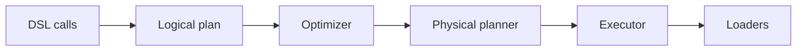

# Architecture

[TOC]

This page shows how Flow is built and what happens to your data between `read()` and `run()`. It is an overview.
Each section links to the page with the details.

## Layers

Flow is built in layers. A layer uses only the layers below it. `mago guard` enforces this rule in CI.

| Layer      | Namespace                | What lives there                                        | Types you meet                                                |
|------------|--------------------------|---------------------------------------------------------|---------------------------------------------------------------|
| DSL        | `Flow\ETL\DSL`           | the functions you call                                  | `data_frame()`, `ref()`, `from_array()`, `to_output()`        |
| API        | `Flow\ETL\API`           | the user-facing objects                                 | `DataFrame`, `ConfigBuilder`, `Branch`, `Transactional`       |
| Runtime    | `Flow\ETL\Runtime`       | the run: config, context, executor, telemetry           | `Config`, `FlowContext`, `Executor`                           |
| Planning   | `Flow\ETL\Planning`      | plans, the optimizer, the physical planner, `explain()` | `LogicalPlan`, `Optimizer`, `PhysicalPlan`                    |
| Operators  | `Flow\ETL\Operators`     | the steps a pipeline runs                               | `Transformer`, `Processor`, `HashJoin`                        |
| IO         | `Flow\ETL\IO`            | reading, writing, schema inference, formatting          | `Extractor`, `Loader`, `FileLoader`, `SaveMode`               |
| Functions  | `Flow\ETL\Functions`     | expressions over columns                                | `ScalarFunction`, `AggregatingFunction`, `WindowFunction`     |
| Kernels    | `Flow\ETL\Kernels`       | the algorithms: sort, hash join, bucketing, hashing     | `ExternalSort`, `Joiner`, `HashBucketing`                     |
| Storage    | `Flow\ETL\Storage`       | where rows wait: cache, spill files, Floe encoding      | `RowsStorage`, `FilesystemRowsStorage`                        |
| Values     | `Flow\ETL\Values`        | the data itself                                         | `Rows`, `Schema`, `Column`, `Backend`                         |
| Foundation | `Flow\ETL\Foundation`    | shared basics: describe/rebuild, exceptions, clock      | `Describable`, `InvalidArgumentException`                     |

`Flow\ETL\Flow` is the one class at the root. It is the object `data_frame()` returns.

Adapters use the same layers inside their own namespace. The CSV reader is
`Flow\ETL\Adapter\CSV\IO\Extractor\CSVExtractor`, and the CSV writer is `Flow\ETL\Adapter\CSV\IO\Loader\CSVLoader`.
DSL functions keep their namespaces: `Flow\ETL\DSL`, `Flow\ETL\Adapter\CSV`, `Flow\Floe\DSL`.

## What happens when you call run()



1. Each DSL call adds a node to a logical plan. Nothing reads data yet.
2. The optimizer rewrites the plan. It pushes filters, limits and offsets into the source. It turns a sort followed
   by a limit into one top-N step. It answers `count()` from source statistics.
3. The physical planner picks an operator for each node. The sort, join, group-by and repartition algorithms come
   from the config. It cuts the plan into pipelines at every step that needs all of its input.
4. The executor pulls batches from the extractor, runs them through the steps and hands them to the loaders.

`explain()` prints each stage. This pipeline reads a CSV file, groups, sorts, limits and writes:

```php
<?php

declare(strict_types=1);

use Flow\ETL\Planning\Logical\Stage;
use Flow\ETL\Planning\Logical\Trigger;

use function Flow\ETL\Adapter\CSV\{from_csv, to_csv};
use function Flow\ETL\DSL\{data_frame, overwrite, ref, sum};

$frame = data_frame()
    ->read(from_csv('/data/orders.csv'))
    ->filter(ref('country')->equals('PL'))
    ->groupBy('country')
    ->aggregate(sum(ref('total')))
    ->sortBy(ref('total_sum')->desc())
    ->limit(10)
    ->write(to_csv('/data/out.csv')->saveMode(overwrite()));

$plan = $frame->explain(Trigger::run);

echo $plan->toString(Stage::unoptimized);
echo $plan->toString(Stage::optimized);
echo $plan->toString(Stage::physical);
```

The logical plan, as written:

```text
#6 Write
│  Loader: CSVLoader
└─ #5 Limit
   │  Limit: 10
   └─ #4 Sort
      │  Sort by: total_sum desc
      └─ #3 Aggregate
         │  Group by: country
         │  Changes columns known only at run time
         └─ #2 Filter
            │  Condition: country = 'PL'
            └─ #1 Read
                  Extractor: CSVExtractor
                  Source: file:///data/orders.csv
```

After the optimizer, `Sort` and `Limit` are one `TopN` node:

```text
#5 Write
│  Loader: CSVLoader
└─ #4 TopN
   │  Top: 10
   └─ #3 Aggregate
      │  Group by: country
      │  Changes columns known only at run time
      └─ #2 Filter
         │  Condition: country = 'PL'
         └─ #1 Read
               Extractor: CSVExtractor
               Source: file:///data/orders.csv
```

The physical plan has three pipelines. Each pipeline ends at a processor or at the loader:

```text
Physical plan
│  Columns: country, total_sum
└─ Pipeline #2
   │  Loader: CSVLoader
   └─ Pipeline #1
      │  Processor: TopNProcessor
      │     Top: 10
      │     Sort by: total_sum desc
      └─ Pipeline #0
            Extractor: CSVExtractor
               Statistics: rows exact 4 · size exact 49 B
            Transformer: ScalarFunctionFilterTransformer
            Transformer: PruneColumnsTransformer
            Processor: GroupByAggregationProcessor
               Group by: country
               Aggregations: Sum
               Memory: 1000 MB
               Storage: FilesystemRowsStorage
               Batch: 1000
```

A limit goes into the source. The `Read` node carries it, so the extractor can stop after 2 rows:

```text
#3 Result
│  Rows this plan hands out: to the trigger, or to the node reading it
└─ #2 Limit
   │  Limit: 2
   └─ #1 Read
         Extractor: CSVExtractor
         Source: file:///data/orders.csv
         Limit: 2
```

The executor writes each loader's rows in one run. A branch (`to_branch()`) sends only the rows that match its
condition to its loader. A transaction (`to_dbal_transaction()`, `to_pgsql_transaction()`) commits its writes
together, or rolls all of them back.

More: [triggers and explain()](/documentation/components/core/core.md),
[sort](/documentation/components/core/sort.md), [join](/documentation/components/core/join.md),
[group by](/documentation/components/core/group-by.md),
[statistics](/documentation/components/core/statistics.md).

## Batches and columns

Rows travel in batches. A batch is a `Rows` object: one `Column` per schema definition, never one PHP array per
row. Every step reads whole columns and returns whole columns.

The backend decides where the columns live. `AdaptiveBackend` is the default. With the native
[flow_php extension](/documentation/components/extensions/flow-php-ext.md) loaded, it uses the extension. Without it,
it uses plain PHP arrays. Both give the same values. Set a backend on the config:

```php
use Flow\ETL\Values\Column\PhpBackend;

use function Flow\ETL\DSL\{config_builder, data_frame, from_array};

data_frame(config_builder()->backend(new PhpBackend()))
    ->read(from_array([['id' => 1], ['id' => 2]]))
    ->fetch();
```

More: [column backend](/documentation/components/core/column-backend.md),
[batch processing](/documentation/components/core/batch-processing.md).

## Writes

Each file loader carries its own save mode: `exception_if_exists()` (the default), `append()`, `ignore()` or
`overwrite()`.

```php
data_frame()
    ->read(from_array([['id' => 1]]))
    ->write(to_csv('/data/out.csv')->saveMode(overwrite()))
    ->run();
```

An overwrite writes its files to a temporary directory in the destination first: `.flow-tmp-<run>-<hash>`. The
commit moves the files into place, then removes the old parts. A failed commit can leave duplicates. It never loses
data. `append()`, `ignore()` and `exception_if_exists()` write in place. If the run fails, they remove the files
they created.

Readers skip every path below the root you name that starts with `.` or `_`. They keep partition directories
(`country=PL`), `_metadata` and `_common_metadata`. Because of this rule, a reader never sees an unfinished
`.flow-tmp-` directory.

More: [save mode](/documentation/components/core/save-mode.md),
[partitioning](/documentation/components/core/partitioning.md).
