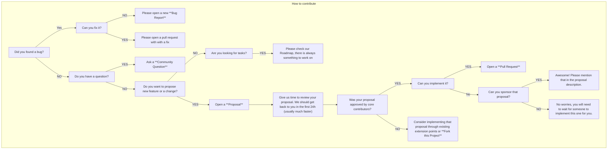

# Contributing

[TOC]

The graph below shows the process to contribute to Flow.

## How to?

- [Submit a Bug Report](https://github.com/flow-php/flow/issues/new?template=bug)
- [Submit a Proposal](https://github.com/flow-php/flow/issues/new?template=proposal)
- Ask Community Question
  - [At Flow Discord Server](https://discord.gg/5dNXfQyACW) 
  - [At GitHub Discussions](https://github.com/flow-php/flow-php.com/discussions/categories/questions)
- [Sponsor Project of Proposal](http://flow-php.com/sponsor/)
- [Project Roadmap](https://github.com/orgs/flow-php/projects/1)

## Project Roadmap

> [!IMPORTANT]
> [GitHub Projects](https://github.com/orgs/flow-php/projects/1) manages Flow PHP.
> First add each code change to the [Roadmap](https://github.com/orgs/flow-php/projects/1) as an item.
>
> A pull request without an item in the Roadmap can take much longer to review. A mismatch with the project architecture
> or the future plans can also get it rejected. To save the time of contributors and maintainers, we want to
> review the proposal before anyone starts to code.
>
> The only exception to that rule is bug fixes. You can open them without a proposal first.
> But contact us first anyway, because some bugs cannot be fixed immediately, or at all.

Your idea can be missing from the [Roadmap](https://github.com/orgs/flow-php/projects/1). Then create a new
[Proposal Issue](https://github.com/flow-php/flow/issues/new?template=PROPOSAL) and wait for more instructions.

A proposal is "Accepted" after one of the Core Contributors adds it to the Roadmap.
By default, proposals go into the next milestone. Work that is not done by the due date of the milestone moves to the
milestone after it.

> Weeks of coding can save you hours of planning. 

A pull request without contact first can be rejected and closed.

Bug Fixes: bug fixes are the only exception to the rule above. You can open a bug fix directly, without a proposal
issue. A bug fix must only fix existing code. Additions, most of all to our DSL, need a `Proposal` first.

## Issue Types 

Use these guidelines to choose the issue type:

### Proposal 

- New feature request
- Idea to change or extend existing behavior
- Something is missing and must be added
- UX/DX improvements

### Bug 

Important: do not use the `Bug` issue type for missing features. Report a `Bug` only for existing code that does not
work as expected. A missing thing needs a `Proposal` first.

- Incorrect behavior of existing code
- Performance degradation 

### Task 

- Only the roadmap manager uses these issues, to split bigger items into smaller tasks

## Before coding

Read our [Architecture Decision Records](/documentation/adrs.md).
You must follow all of them without exceptions. Only a new ADR can explicitly override one.

## Next Steps

- [Setup development environment](/documentation/contributing/environment.md)
  - [Nix Shell](/documentation/contributing/nix.md)
- [Development Guidelines](/documentation/contributing/guidelines.md)
- [Benchmarks](/documentation/contributing/benchmarks.md)
- Extension Development
  - [Rust: arrow-ext & flow-php-ext](/documentation/contributing/rust.md)
  - [C: pg-query Extension](/documentation/contributing/c.md)
  - [WASM: Interactive Playground](/documentation/contributing/wasm.md)
